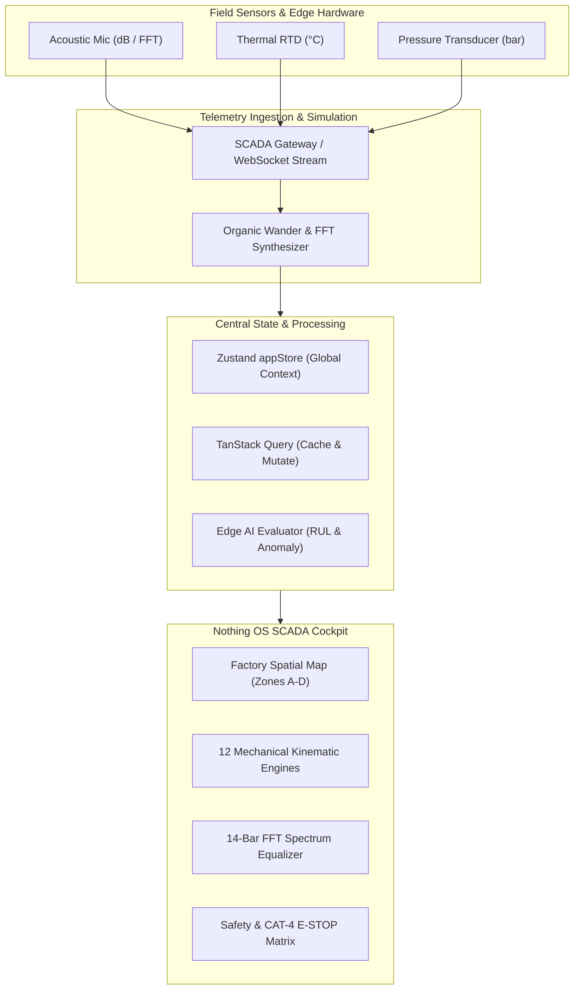

# IndustrialSense // Autonomous Industrial SCADA & Telemetry Platform

[](https://www.typescriptlang.org/)
[](https://reactjs.org/)
[](https://vitejs.dev/)
[](https://tailwindcss.com/)
[](LICENSE)

> **Codesprint 2026 Production Release**  
> An autonomous industrial SCADA platform engineering next-generation human-machine interfaces. Features physics-driven 2D digital twin animations, multi-modal sensor telemetry (Acoustic, Thermal, Pressure), and edge AI predictive diagnostics styled in a retro-futuristic **Nothing OS Industrial Cockpit** aesthetic.

---

## 1. Executive Summary

Modern industrial facilities often suffer from fragmented monitoring: sensor telemetry is disconnected from spatial location, digital twins are static 3D renderings that load sluggishly on edge gateways, and alarm systems inundate operators with uncontextualized alerts.

**IndustrialSense** bridges this gap:
- **Spatial SCADA Cockpit**: A vector-based factory spatial map spanning Zones A–D with dynamic automated guided vehicle (AGV) corridors, overhead crane tracks, and interactive machine nodes.
- **Physics-Based Kinematic Digital Twins**: 12 dedicated SVG/Canvas mechanical animation engines featuring real kinematic movements (spur gears, radial impellers, reciprocating pistons, articulated robotic joints, and high-speed spindles) with zero WebGL/3D overhead.
- **Tri-Modal Sensor Fusion**: Standardized telemetry tracking **Sound (Acoustic FFT & Cavitation)**, **Temperature (Thermal RTD & Gradients)**, and **Pressure (Line & Differential Head $\Delta P$)**.
- **Edge AI & Predictive Maintenance**: Real-time Remaining Useful Life (RUL) calculations, anomaly detection confidence scoring, and instantaneous emergency shutdown (E-STOP CAT-4) dispatch.
- **Nothing OS Design Paradigm**: High-contrast dark industrial palette (`#08080a`, `#121315`), dot-matrix typography (`Ndot 55`, `Ndot 57`, `NType 82`), CRT scanline effects, and pulsing LED rings.

---

## 2. System Architecture

```
INDUSTRIAL-SENSE/
├── docs/                 # Engineering documentation & Page/Asset inventory
│   └── PAGE_INVENTORY.md # Detailed specification of routes, components, and telemetry
│
├── frontend/             # Complete React 18 + TypeScript + Vite production application
│   ├── public/
│   │   ├── fonts/        # Proprietary Nothing OS fonts (Ndot55, Ndot57, NType82)
│   │   └── favicon.svg   # Platform brand asset
│   ├── src/
│   │   ├── app/          # App root, React Router v6 routing, TanStack Query providers
│   │   ├── components/   # Modular, encapsulated SCADA components
│   │   │   ├── ai-insights/        # AnomalyCard, AIInsightPanel, RUL gauges
│   │   │   ├── alerts/             # Active alerts queue, acknowledgment workflows
│   │   │   ├── analytics/          # Trend charts, multi-sensor correlation, FFT spectrum
│   │   │   ├── common/             # SearchBar, Modal, Toast notifications, ConfirmDialog
│   │   │   ├── dashboard/          # MetricSummary, FactoryMap, NodeInspector, QuickFilters
│   │   │   ├── layout/             # AppLayout, TopNavbar, Sidebar, Breadcrumbs
│   │   │   ├── machine-animations/ # 12 Dedicated mechanical kinematic SVG engines
│   │   │   ├── machines/           # MachineCard, MachineTable, CAD schematics
│   │   │   ├── monitoring/         # Live sensor streams, FFT audio visualizers
│   │   │   ├── reports/            # Shift summary generator, CSV/PDF export simulation
│   │   │   ├── sensors/            # SoundSensorPanel, TemperaturePanel, PressurePanel
│   │   │   └── settings/           # UserProfile, SensorThresholds, RBAC Matrix
│   │   ├── data/         # 15 Machine categories, 12 priority machines, mock telemetry
│   │   ├── hooks/        # React Query hooks (useMachines, useSensorReadings, useAlerts)
│   │   ├── pages/        # Core page views (Landing, Dashboard, Analytics, Registration, etc.)
│   │   ├── services/     # Axios client, REST simulation, WebSocket stream emulator
│   │   ├── store/        # Zustand appStore (Auth, active machine context, alerts)
│   │   ├── types/        # Strict TypeScript interfaces (Machines, Sensors, Telemetry)
│   │   └── utils/        # Unit formatters, threshold evaluators, status badges
│   ├── package.json
│   ├── tailwind.config.js
│   └── vite.config.ts
│
├── UI/                   # UI design reference mockups and visual prototypes
├── backend/              # Staging directory for external API & WebSocket gateways
└── .gitignore            # Git configuration ignoring node_modules, dist, and local caches
```

---

## 3. Data & Telemetry Flow Architecture



---

## 4. Core Application Pages & Modules

The platform is designed around **6 primary application modules**:

| # | Page / Module | Route | Highlights & Features |
| :-: | :--- | :--- | :--- |
| **1** | **Landing Page & Research Thesis** | `/` | 60 FPS HTML5 Canvas mechanical engine (impeller, 3 spur gears, slider-crank piston, 180 particles), 5 swaying machinery tool cards, thesis summary, and live lab metrics. |
| **2** | **SCADA Cockpit Dashboard** | `/dashboard` | Interactive Factory Spatial Map (SVG 860x520, Zones A-D, AGV tracks, live crane glide), Quick Filter Ribbon (KPI metrics), Node Inspector flyout, and E-STOP command center. |
| **3** | **Machine Deep Analytics** | `/analytics`, `/analytics/:id` | Technical 2.5D CAD line art schematic of Centrifugal Pump (`mch-pmp-01`), 4 overlay callout badges, radial condition score gauge (78%), Canvas temperature sparklines, and 14-bar dancing FFT equalizer. |
| **4** | **Hardware Registration** | `/machine-registration` | Hardware Register & Provisioning Directory, 4 SVG Vector CAD schematics (PMP-01, CNC-01, HYD-01, ASRS-19), auto-generated MAC addresses, DXF export, and dynamic CAD dropzone. |
| **5** | **Security Gateway & Access Portal** | `/login`, `/register`, `/portal` | SIL-4 rated authentication gateway with Operator Sign-In and New Enrollment mode toggle, 16-byte RFID/NFC badge simulation, supervisor credentials, and biometric 2FA. |
| **6** | **Operator Profile & Safety Settings** | `/profile`, `/settings` | Operator credentials, assigned shift context, sensor alarm threshold sliders (Cavitation, Temp, Pressure, Vibration), safety escalation matrix, and immutable SIL-4 audit trail. |

---

## 5. The 12 Mechanical Kinematic Digital Twin Engines

Instead of generic looping GIFs or heavyweight WebGL models, IndustrialSense features **12 pure SVG/Canvas physics-based animation engines** with customizable controllers (Play/Pause, Speed 0.5x–2x, Click-to-Inspect component callouts, and sensor hotspot overlays):

1. **Centrifugal Pump (`mch-pmp-01`)**: Volute casing, suction/discharge flanges, 6-vane radial impeller, dynamic fluid vector particles, and mechanical seal inspection.
2. **CNC 5-Axis Milling Machine (`mch-cnc-01`)**: Dual gantry columns, sliding T-slot table, rotating high-speed electro-spindle, and simulated titanium chip sparks.
3. **CNC Heavy Lathe (`mch-lth-01`)**: Cast headstock, 3-jaw chuck, rotating billet workpiece with step cuts, and traversing tool turret with TiN carbide inserts.
4. **3-Phase Induction Motor (`mch-mtr-01`)**: Ribbed cooling fins, terminal box, drive-end shaft, and external cowl fan with spinning blades.
5. **Heavy Belt Conveyor (`mch-cnv-01`)**: Structural truss framework, motorized head pulley, tension idlers, textured rubber belt, and moving ore cargo.
6. **Industrial Exhaust Fan (`mch-fan-01`)**: Circular aerodynamic duct shroud, safety wire guard, 4 curved blades, and velocity draft wavefronts.
7. **Reciprocating Air Compressor (`mch-cmp-01`)**: Cast crankcase, finned cylinder bore, dual reed valves, reciprocating piston, connecting rod, and counterbalanced crankshaft.
8. **500-Ton Hydraulic Forging Press (`mch-prs-01`)**: Heavy tie rod columns, crown cylinder, polished chrome ram, and downward forging stroke shockwaves.
9. **6-Axis Articulated Welding Robot (`mch-rob-01`)**: Cast pedestal base, articulated shoulder/elbow links, harmonic wrist, and laser seam torch with electric blue arcs.
10. **Steam Turbine (`mch-trb-01`)**: Conical pressure expansion casing, central rotor shaft, 4 multi-stage expanding blade aerofoil discs, and steam stream rays.
11. **Industrial Batch Agitator / Mixer (`mch-mix-01`)**: Top-entry motor drive, sanitary seal, suspended shaft, dual hydrofoil mixing blades, and fluid vortex simulation.
12. **Heavy Helical Gearbox (`mch-gbx-01`)**: Case-hardened housing, lube oil sump, input high-speed 12-tooth pinion gear meshing with a 24-tooth low-speed bull gear.

---

## 6. The 3 Supported Industrial Sensor Modalities

IndustrialSense standardizes industrial telemetry into 3 essential physical domains:

### 1. Sound & Acoustic Mic (`dB` / `dB(A)`)
- **FFT Spectrum Analysis**: Real-time 14-bar frequency visualization covering $20\text{ Hz} - 20\text{ kHz}$.
- **Fault Detection**: Detects cavitation turbulence, bearing race micro-spalling, and gear meshing harmonics.
- **Thresholds**: Normal: $<78\text{ dB}$, Warning: $78-85\text{ dB}$, Critical: $>85\text{ dB}$.

### 2. Temperature & Thermal RTD (`°C` / `°F`)
- **Thermal Dynamics**: Real-time gradient monitoring ($\Delta T / \text{min}$) with organic thermal drift simulation.
- **Fault Detection**: Detects dry running, stator insulation breakdown, lubrication oil thinning, and friction overload.
- **Thresholds**: Normal: $<75^\circ\text{C}$, Warning: $75-90^\circ\text{C}$, Critical: $>90^\circ\text{C}$.

### 3. Pressure Transducers (`bar` / `PSI`)
- **Hydrodynamic Analysis**: Differential head pressure ($\Delta P = P_{\text{discharge}} - P_{\text{suction}}$) and Net Positive Suction Head available ($NPSH_a$).
- **Fault Detection**: Detects dead-heading, line blockages, seal blowout, and pressure surges.
- **Thresholds**: Normal: $4.0 - 7.5\text{ bar}$, Warning: $7.5 - 9.0\text{ bar}$, Critical: $>9.0\text{ bar}$.

---

## 7. Design System & Aesthetics (Nothing OS SCADA)

The user interface follows a strict **Nothing OS Industrial SCADA Cockpit** design language:

* **Dark Cockpit Palette**:
  * Backgrounds: Deep Void (`#08080a`), Sub-panel (`#101014`), Card Surface (`#131318`), High-contrast Border (`#2a2a34`).
  * Signals: Signal Crimson (`#d71920`), Electric Cyan (`#00E5FF`), Warning Amber (`#F59E0B`), Safety Emerald (`#10B981`).
* **Typography Stack**:
  * **Ndot 55 & Ndot 57**: Dot-matrix mechanical display font used for primary headers, machine IDs, and status glyphs.
  * **NType 82 & NType 82 Mono**: Technical grotesk font used for card headers and telemetry figures.
  * **Space Mono**: Monospace font used for raw telemetry streams, MAC addresses, and timestamps.
  * **Inter**: Clean sans-serif font used for descriptions, labels, and form controls.
* **Tactile Feedback & Visual Polish**:
  * Subtle CRT scanline background rastering.
  * Pulsing LED beacons and animated SVG dashed conveyor/AGV trails.
  * High-contrast glassmorphic panels (`backdrop-blur-md`).

---

## 8. Role-Based Access Control (RBAC)

The security gateway simulates 4 distinct operational roles with customized permissions:

| Role | Permissions |
| :--- | :--- |
| **System Administrator** (`admin`) | Full telemetry access, threshold overrides, machine provisioning, user provisioning, CAT-4 E-STOP initiation. |
| **Reliability Engineer** (`engineer`) | Deep analytics, FFT spectrum inspection, CAD schematic export, alert acknowledgment, report generation. |
| **SCADA Operator** (`operator`) | Real-time monitoring, machine status switching (Run/Stop/Maint), live alert triage, spatial map navigation. |
| **Safety Auditor** (`viewer`) | Read-only access to immutable SIL-4 audit logs, compliance reports, and historical trend archives. |

---

## 9. Technology Stack

| Layer | Technologies |
| :--- | :--- |
| **Core Framework** | React 18.3, TypeScript 5.6 |
| **Bundling & Tooling** | Vite 5.4, PostCSS, Autoprefixer |
| **Styling & Design** | Tailwind CSS 3.4, Custom Nothing OS Theme, CSS Keyframes |
| **Animation Engines** | Native SVG Vector Kinematics, HTML5 Canvas 2D, Framer Motion, GSAP |
| **Data Visualization** | Recharts (multi-axis line charts, FFT spectrum bars) |
| **State Management** | Zustand 5.0 (Global application state, alerts, user session) |
| **Data Fetching** | TanStack React Query 5.62 (Caching, polling, optimistic updates) |
| **Form Handling** | React Hook Form, Zod schema validation |
| **Icons & Glyphs** | Lucide React (Industrial telemetry, sensor, and hardware icons) |

---

## 10. Getting Started

### Prerequisites
- **Node.js**: Version 18.0.0 or higher
- **npm**: Version 9.0.0 or higher

### Installation & Local Development

1. **Clone the repository:**
   ```bash
   git clone https://github.com/123priyanshu123/INDUSTRIAL-SENSE.git
   cd INDUSTRIAL-SENSE
   ```

2. **Navigate to the frontend directory:**
   ```bash
   cd frontend
   ```

3. **Install dependencies:**
   ```bash
   npm install
   ```

4. **Start the local development server:**
   ```bash
   npm run dev
   ```
   Open [http://localhost:5173](http://localhost:5173) in your web browser.

5. **Build for production release:**
   ```bash
   npm run build
   ```
   The optimized production bundle will be generated in `frontend/dist/`.

6. **Preview the production build locally:**
   ```bash
   npm run preview
   ```

---

## 11. Quick Route Directory

When running the application, you can navigate directly to the following routes:

- `/` — **Landing Page & Research Thesis**: 2D kinematics canvas and project introduction.
- `/dashboard` — **SCADA Cockpit**: Interactive factory floor map and active alert dispatch.
- `/analytics` — **Machine Deep Analytics**: 2.5D CAD schematic, FFT equalizer, and condition scores.
- `/machine-registration` — **Hardware Provisioning**: Register machines, upload CAD files, export DXF.
- `/login` / `/portal` — **Security Gateway**: Operator sign-in, NFC badge simulation, and 2FA.
- `/profile` / `/settings` — **Safety Matrix & Profile**: Adjust sensor thresholds, view audit logs.

---

## 12. License

This project is licensed under the MIT License — see the [LICENSE](LICENSE) file for details.
